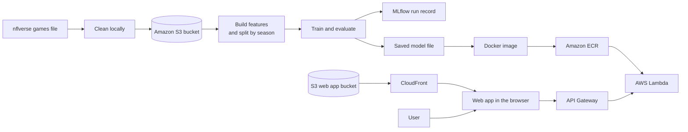
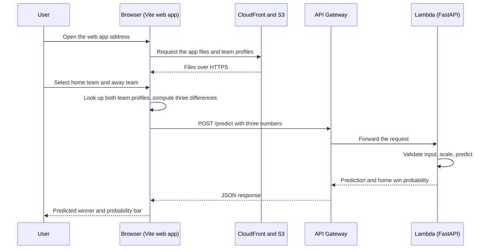
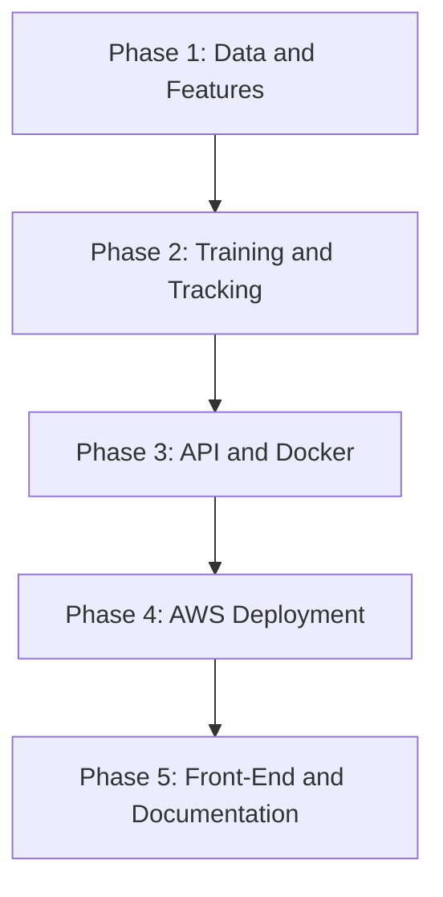

---
hide:
  - toc
---

# Architecture Overview

This guide is the detailed design specification for the NFL Pre-Game Matchup Predictor. The system predicts the winner of an upcoming NFL game before kickoff. A user picks a home team and an away team in a web app, and the app returns a predicted winner and a win probability.

The prediction uses three comparisons between the two teams: season-to-date point differential per game, season-to-date win percentage, and days of rest. The system leaves out play-by-play data, injuries, and any live information. It is meant as a small, complete example of a machine learning system that runs from data storage to a public web app.

This guide holds the whole-system view. Five phase documents hold the detailed design for each build step. No configuration files, code, or cloud resources are created by these documents. They describe what to build and how to check it.

!!! note "How these documents relate to the earlier ones"
    The earlier assignment brief, requirements list, first design draft, and list of gaps are kept unchanged in the Initial Requirements section. Every gap on that list is resolved or assigned a proposed answer in one of the phase documents. See [Gap Register](#gap-register).

## Where to Read Next

| Order | Document | What it covers |
| :--- | :--- | :--- |
| 1 | This page | System purpose, flow, components, run environment, build plan, and traceability. |
| 2 | [Phase 1: Data and Features](./implementation/phase-1-data-and-features.md) | Source data, cleaning, S3 upload and download, feature definitions, and the chronological split. |
| 3 | [Phase 2: Training and Tracking](./implementation/phase-2-training-and-tracking.md) | Pipeline configuration, model choice, evaluation, and MLflow logging. |
| 4 | [Phase 3: API and Docker](./implementation/phase-3-api-and-docker.md) | The `/predict` contract, the model-loading rules, and the Docker image. |
| 5 | [Phase 4: AWS Deployment](./implementation/phase-4-aws-deployment.md) | Lambda, API Gateway, ECR, permissions, and cost limits. |
| 6 | [Phase 5: Front-End and Documentation](./implementation/phase-5-front-end-and-documentation.md) | The Vite web app, S3 and CloudFront hosting, README contents, and the final repository check. |
| 7 | [Glossary](./implementation/glossary.md) | Plain-language meaning of every football, data, modeling, AWS, and web term used in these guides. |

## What Does the System Do?

The system has two halves. The first half runs once per model version, on a developer machine: it downloads game results, builds features, trains a model, and records the run. The second half runs on every user request: the web app turns two team names into three numbers, sends them to a public API, and shows the answer.

The same request path, step by step:

## What Does the System Leave Out?

| Left out | Reason |
| :--- | :--- |
| Play-by-play data and live game state | The prediction is made before kickoff, so none exists yet. |
| Injuries, weather, quarterback changes | These need data sources that are not in the games file. |
| Betting lines | The games file contains them, but they are excluded so the model uses only team performance and rest. |
| Playoff games | Only regular-season games are used. |
| Games before 2016 and after 2024 | The study window is the 2016 to 2024 regular seasons. |
| User accounts and stored requests | The API is stateless and stores nothing. |

## Which Components Make Up the System?

| Component | Technology | Built in | What it does |
| :--- | :--- | :--- | :--- |
| Source data | nflverse `games.csv` | Phase 1 | One row per NFL game since 1999, with scores and rest days. |
| Cloud data store | Amazon S3 | Phase 1 | Holds the cleaned game table that the pipeline reads. |
| Feature and split step | Python, pandas | Phase 1 | Builds the three comparison features and splits games by season. |
| Training step | scikit-learn | Phase 2 | Fits and scores the model. |
| Run tracking | MLflow | Phase 2 | Records settings, scores, and files for each run. |
| Pipeline settings | `config.yaml` | Phase 2 | Holds every adjustable setting. |
| Prediction API | FastAPI with Mangum | Phase 3 | Answers `POST /predict`. |
| Container image | Docker | Phase 3 | Packages training and serving. |
| Image registry | Amazon ECR | Phase 4 | Stores the serving image. |
| Hosting | AWS Lambda and API Gateway | Phase 4 | Runs the API and gives it a public address. |
| Web app | Vite (React with TypeScript proposed) | Phase 5 | Collects two team names, calls the API from the browser, and shows the result. |
| Web app hosting | Amazon S3 and CloudFront | Phase 5 | Stores the built web app files in a private bucket and serves them over HTTPS. |

## What Is the Run Environment?

This is the one place the environment is stated. Other pages refer to it.

| Need | Requirement |
| :--- | :--- |
| Language | Python 3.13. The local virtual environment uses 3.13.14. The Lambda image must use the same minor version, so confirm AWS offers a Python 3.13 Lambda base image before building. |
| Python dependencies | Installed from `requirements.txt` with exact versions recorded from a working install. Phase 3 adds a smaller serving list. |
| Web app dependencies | Installed from `frontend/package.json` with npm. Exact versions are recorded in the lock file. |
| Containers | Docker Desktop. This Mac builds `arm64` images by default, which Phase 4 accounts for. |
| Web app tools | Node.js and npm. Use a current long-term-support release of Node.js that the chosen Vite version supports. Check the minimum version Vite states when the project is created. |
| AWS | An AWS account, AWS CLI version 2, and credentials configured on the machine. |
| Network | Internet access to GitHub (source data), S3, ECR, and API Gateway. |
| Documentation tools | MkDocs with the Material theme, kept out of the project dependency files. |

## How Is the Work Split Into Phases?

Each phase is one branch, one pull request, and a short run of commits. The developer names each branch when that phase starts. The phase boundaries match the five breakpoint markers in the first design draft.

| Phase | The phase is finished when |
| :--- | :--- |
| 1 | The cleaned file is in S3, a script downloads it, and the feature step produces the three features with a check that no feature uses future games. |
| 2 | One command trains from `config.yaml`, prints the scores, and logs to MLflow. |
| 3 | `/predict` answers a local request and the Docker image builds and runs both entry points. |
| 4 | A public URL returns a valid prediction to a test request. |
| 5 | The public web app calls the live API and the README holds every required link. |

Git commands are run by the developer. Each phase document suggests how to group commits, and the pull request is opened and merged by the developer. The project is built by one person. Any text or code produced by an AI assistant is reviewed by that person before it is committed.

## Which Phase Covers Which Requirement?

The numbers refer to the [Project Requirements](./initial-requirements/requirements.md).

| Requirement | Covered in | Where the detail lives |
| :--- | :--- | :--- |
| 1. Problem and dataset | Phase 1, Phase 2 | Dataset and target in Phase 1. Metric and baseline in Phase 2. |
| 2. Amazon S3 storage | Phase 1 | Upload and download steps. |
| 3. Reproducible pipeline | Phase 1, Phase 2 | Features and split in Phase 1. Training and settings in Phase 2. |
| 4. Experiment tracking | Phase 2 | MLflow contents. |
| 5. Docker | Phase 3 | Image layout and local checks. |
| 6. Prediction API | Phase 3 | Request and response contract. |
| 7. AWS deployment | Phase 4 | Lambda, API Gateway, and checks. |
| 8. Front-end | Phase 5 | Vite web app and S3 with CloudFront hosting. |
| 9. Repository contents | Every phase, final check in Phase 5 | Phase plan above, file list in Phase 5. |
| 10. README | Phase 5 | Required sections and links. |

## What Does the Final Repository Look Like?

This is the planned layout. It follows the first design draft with the changes listed in the gap register. Nothing in this tree exists yet except the documentation.

| Path | Purpose | Built in |
| :--- | :--- | :--- |
| `config/config.yaml` | Every adjustable pipeline setting. | Phase 2 |
| `data/` | Local working copies of the source file and the cleaned file. Not committed. | Phase 1 |
| `src/clean.py` | Cleans the source file and maps old team codes. | Phase 1 |
| `src/s3_io.py` | Uploads the cleaned file to S3 and downloads it. | Phase 1 |
| `src/features.py` | Builds the three features, the target, and the team profiles file. | Phase 1 |
| `src/train.py` | Runs the pipeline and logs to MLflow. | Phase 2 |
| `src/evaluate.py` | Scores the model and draws the plots. | Phase 2 |
| `api/app.py` | FastAPI app with `/predict`. | Phase 3 |
| `api/handler.py` | Lambda entry point that wraps the app. | Phase 3 |
| `models/` | The saved model file. Not committed. | Phase 2 |
| `Dockerfile` | One file with a training target and a serving target. | Phase 3 |
| `requirements.txt` and `requirements-serve.txt` | Full and serving dependency lists. | Phase 1 and Phase 3 |
| `frontend/` | The Vite project: `package.json`, `index.html`, and the source in `src/`. | Phase 5 |
| `frontend/public/team-profiles.json` | Team numbers the web app reads. Committed. | Phase 1 |
| `README.md` | Overview, results, setup, and public links. | Phase 5 |

The first design draft also listed `.github/workflows/deploy.yml`. This guide proposes dropping it. See [Phase 4](./implementation/phase-4-aws-deployment.md#step-6-decide-how-deployment-is-repeated).

## Gap Register

Every gap from [Design Gaps and Open Questions](./initial-requirements/design-gaps-and-open-questions.md) is assigned to one phase document. That document gives the proposed answer and the reason. Items marked **Confirm** have a real alternative, so check them before building.

**[Phase 1: Data and Features](./implementation/phase-1-data-and-features.md)**

- Dataset link
- S3 upload step
- Team profiles file for the web app
- Dependency list fix (the serving list is in Phase 3)
- Old team codes (`OAK` and `SD`)
- Bucket name
- Tied games. **Confirm**
- Window for season-to-date numbers and week 1. **Confirm**
- The constant `home_advantage` feature. **Confirm**

**[Phase 2: Training and Tracking](./implementation/phase-2-training-and-tracking.md)**

- Scaler saved together with the model, so the API cannot skip it
- Use of the validation season. **Confirm**
- Where MLflow results are kept

**[Phase 3: API and Docker](./implementation/phase-3-api-and-docker.md)**

- Local Docker and API checks
- Meaning of the probability field. **Confirm**
- One Dockerfile for training, local serving, and Lambda. **Confirm**
- Where the model file lives
- Serving dependency list

**[Phase 4: AWS Deployment](./implementation/phase-4-aws-deployment.md)**

- AWS region. **Confirm**
- Permissions and the CORS rules the browser-based web app needs
- The `deploy.yml` file. **Confirm**
- Public route without a key. **Confirm**

**[Phase 5: Front-End and Documentation](./implementation/phase-5-front-end-and-documentation.md)**

- README contents, including the dataset link and the evaluation result
- End-of-season team profiles and the rest-day default. **Confirm**

**Settled on this page**

- Branch and pull request plan: one branch and one pull request per phase. The developer chooses the branch names when each phase starts.
- Design file name: the first design draft calls itself `design.md` in its file tree, but its real file name is `system_architecture_implementation_design.md`. These guides use real file names only.
- Who runs each phase: one person, as described above.
