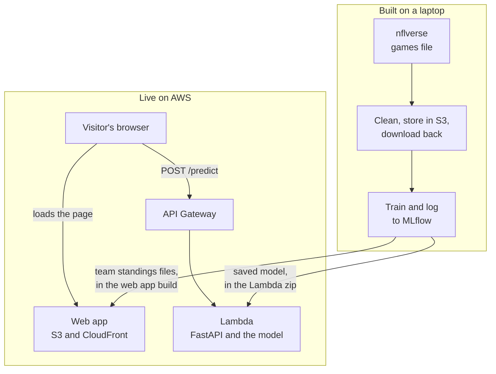
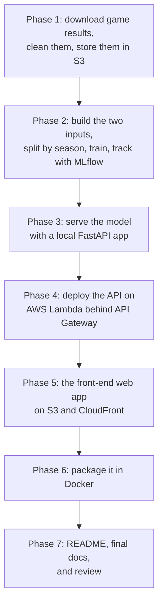

---
hide:
  - toc
---

# Overview

A pre-game NFL winner predictor, built as a complete machine learning system: the data is stored in Amazon S3, a reproducible pipeline trains and tracks a model with MLflow, the model is served as an API on AWS Lambda, and a web app on CloudFront calls that API. Pick a home team and an away team, and the app shows the predicted winner and each team's chance of winning. The repository's [README](https://github.com/jconnors23/510-m3-nfl-prediction-analytics#readme) has the same summary and the full setup commands.

**Demo video:**

<div class="video-embed">
  <iframe src="https://www.youtube-nocookie.com/embed/Om_aYeCCiZE" title="NFL Prediction Model demo video" loading="lazy" referrerpolicy="strict-origin-when-cross-origin" allow="accelerometer; clipboard-write; encrypted-media; gyroscope; picture-in-picture; web-share" allowfullscreen></iframe>
</div>

If the video does not load, [watch it on YouTube](https://youtu.be/Om_aYeCCiZE).

- **Live web app:** [https://d1nubiunzfwm0q.cloudfront.net](https://d1nubiunzfwm0q.cloudfront.net)
- **Live API:** `https://9awodatqc5.execute-api.us-east-1.amazonaws.com` (`POST /predict`, `GET /health`)
- **Code:** [github.com/jconnors23/510-m3-nfl-prediction-analytics](https://github.com/jconnors23/510-m3-nfl-prediction-analytics)
- **Course:** Duke AIPI 510
- **Model version:** 1.0, November 2026. See the [Version 1.0 Release Notes](./implementation/extras/release-notes/version-1-0.md).

!!! info "Owner and Developer"
    **Josiah Connors** designed and built this project, and owns it. GitHub: [@jconnors23](https://github.com/jconnors23). The design, how it was implemented, and the details behind each choice are on [Design Manifest](./implementation/design-manifest.md).

!!! info "Data Source: nflverse"
    **Every game in this project comes from [nflverse](https://github.com/nflverse), an open-source project that publishes NFL data.** This project downloads one file, cleans it, and stores its own copy. It does not change the source, and it is not affiliated with nflverse.

!!! warning "Unofficial Coursework Project"
    **This project is not affiliated with or endorsed by the National Football League.** Team names are used only to identify the teams. The predictions are for reference only.

## Project Overview

The project answers one question before kickoff: **will the home team win?** It is a binary classification task. The target is `home_win` (1 if the home team won, 0 if the away team won), and the metric that judges the model is **accuracy**, compared with the always-pick-the-home-team baseline.

Teams that win more often, and outscore opponents by more, tend to win later games. So the model compares the two teams on two numbers, using only games already played earlier in the same season, and a logistic regression turns them into a home win probability. The model is deliberately simple, so every part of the system around it can be built, checked, and explained: storage, tracking, serving, deployment, and a web app.



## Where Does the Data Come From?

- **The source:** [nflverse](https://github.com/nflverse) is a group of open-source projects that publish NFL data, such as game results, schedules, play-by-play, and rosters.
- **The file:** the nflverse games file, [`games.csv`](https://github.com/nflverse/nfldata/blob/master/data/games.csv), sourced from the nflverse [`nfldata`](https://github.com/nflverse/nfldata) repository. It has one row per NFL game since 1999, with the season, the week, the two teams, the date and kickoff time, and the final score of each finished game.
- **The copy this project uses:** downloaded on 2026-11-17 by `python -m src.data.fetch_raw`, with 7,548 rows and 46 columns. It is committed unchanged as `data/raw/games.csv`, so the project can be rebuilt from the same file even after nflverse updates it.
- **Games used:** regular-season games from 2020 through week 10 of 2026, without ties: **1,759 games**, with 7 of the 46 columns. The web app also reads the 2026 schedule from the same file.
- **Stored in S3,** downloaded back, and committed in `data/`, so every later step starts from the cloud copy and the project trains with no download and no AWS account. How the file is cleaned is in [Phase 1: Data Pipeline](./implementation/phase-1/index.md).
- **What it does not hold:** injuries, weather forecasts, rosters, or play-by-play. The model uses none of these. [Future Considerations](./implementation/extras/release-notes/future-considerations.md) lists other nflverse files as possible additions.

## Model and Evaluation

- **Inputs:** the home team's win percentage minus the away team's, and the home team's point margin per game minus the away team's, each from earlier games of the same season only.
- **Model:** a standard scaler and a logistic regression (scikit-learn), giving a home win probability. Above 0.5 picks the home team.
- **Split by season:** training 2020 to 2024 (1,339 games), validation 2025 (271), test 2026 weeks 1 to 10 (149).
- **Validation accuracy: 63.10%** (171 of 271), against 53.87% for always picking the home team. **Test accuracy: 59.06%** (88 of 149), against 47.65%.
- **Every run is tracked in MLflow.** The path from data to a served prediction is on [ML Workflow](./implementation/extras/architecture/ml-workflow.md).

## Cloud Services

S3 for the data and the web app, Lambda for the prediction and feedback functions, API Gateway for the public API, CloudFront for the web app, DynamoDB for feedback, and IAM and CloudWatch Logs, all in `us-east-1`. GitHub Actions runs the tests and publishes the docs to GitHub Pages and the web app to CloudFront. See [Cloud Architecture](./implementation/extras/architecture/cloud-architecture.md).

## Setup and Usage

You need Python 3.13 and `make`, and for the web app Node.js 22.12 or later.

```bash
python3.13 -m venv .venv
```

```bash
.venv/bin/python -m pip install -r requirements.txt
```

```bash
make train
```

```bash
make start
```

The API then answers at `http://127.0.0.1:8000`. Every command is on [Makefile](./implementation/extras/development/makefile.md), and the local setup as a whole is on [Running Locally](./implementation/extras/development/running-locally.md). Deploying is a set of written steps in [Deploy the API](./implementation/phase-4/deployment-guide.md) and [Deploy the Web App](./implementation/phase-5/deployment-guide.md).

## How Was It Built?

The project was built in seven phases. Each phase ends with something that runs, and each was merged into `main` through its own pull request.



- **[Phase 1: Data Pipeline](./implementation/phase-1/index.md)** fetches the raw game file, cleans it, uploads the cleaned table to a private S3 bucket, and downloads it back.
- **[Phase 2: Features, Training, and Tracking](./implementation/phase-2/index.md)** builds the two inputs, splits games by season, trains and scores the model against the always-pick-home baseline, and records every run in MLflow.
- **[Phase 3: Local Prediction API](./implementation/phase-3/index.md)** serves the model on a laptop with FastAPI `/predict` and `/health` routes, and rejects bad input with a clear error.
- **[Phase 4: AWS Deployment](./implementation/phase-4/index.md)** runs the same API on AWS Lambda behind API Gateway, and checks that all 1,759 games get the same answers from the deployed model as from the local one.
- **[Phase 5: Front-End Web App](./implementation/phase-5/index.md)** builds the five-tab Vite web app, hosts it in a private S3 bucket behind CloudFront, and checks every home-and-away pair of teams and every 2026 game against the live API.
- **[Phase 6: Docker](./implementation/phase-6/index.md)** packages the project in one Dockerfile with a `train` target and a `serve` target, and checks that the container reproduces the run summary and the worked example.
- **[Phase 7: Review](./implementation/phase-7/index.md)** writes the README, checks the docs and comments against the code, and walks the requirements with evidence.

Each phase is one page under **Developer Docs → Version 1**. It opens with an overview that links the pull requests that delivered it, then has a Development Guide section and an Implementation section. The rest of the Developer Docs covers how the system fits together (System Design), how to set up, run, and test it (Local Development), and the AWS commands to deploy it (Deployment). The Extras are listed under [Where Is Everything Else?](#where-is-everything-else).

## Limitations

- The model sees only two numbers, and is wrong on about 37% of the 2025 validation games and 41% of the 2026 test games.
- It leans toward the home team, picking it in 172 of 271 games in 2025, while the home team won 146.
- The web app collects no personal data, and the feedback form asks for no name or contact details.
- Predictions are for reference only.

## What Came Before This Project?

This is the third project in a series of NFL analytics coursework for Duke AIPI 510, all built on nflverse data. Nothing in this project uses the earlier projects' code, data, or results.

- **[Module 1: NFL Data Storytelling](https://github.com/jconnors23/510-m1-nfl-data-storytelling).** Ranks all 32 teams by win-loss record and by point differential for the 2024 regular season, and finds the five teams whose two rankings differ by at least six places. Its conclusion is that neither measure alone fully describes how good a team was.
- **[Module 2: NFL Statistical Analysis](https://github.com/jconnors23/510-m2-nfl-statistical-analysis).** A pilot statistical study of one week's 13 games. It asks whether a sports-media personality's weekly picks were followed by a different change in each game's published pre-game win chances than the games he did not pick. The difference it found was not statistically significant (p = 0.175), so it reads as a direction for a larger study, not a confirmed effect.
- **[Week 13 Sync Activity](https://github.com/jconnors23/510-wk13-sync-activity).** A small class activity: a semantic search page for the 257 picks of the 2025 NFL draft, built with an embedding model, a vector database, and Gradio, and published as a Hugging Face Space.

## Where Is Everything Else?

- [Requirements Rubric](./implementation/requirements/requirements-rubric.md): every requirement of the assignment, linked to the code and docs that meet it.
- [Design Manifest](./implementation/design-manifest.md): how the project was built with AI tools, with choices and why.
- [Project Requirements](./implementation/requirements/project-requirements.md): the assignment's requirements, unchanged.
- [Version 1.0 Release Notes](./implementation/extras/release-notes/version-1-0.md): what the November 23, 2026 release holds.
- [Future Considerations](./implementation/extras/release-notes/future-considerations.md): what could come next.
- [Glossary](./implementation/extras/glossary.md): plain-language meaning of the terms used here.
