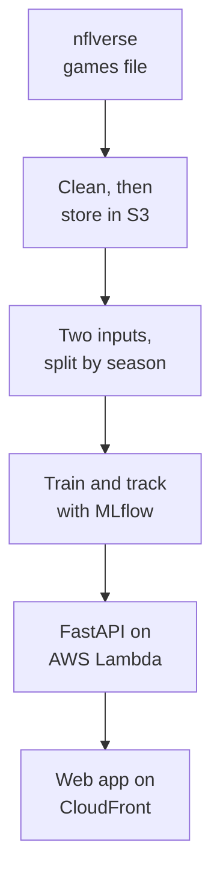

---
hide:
  - toc
---

# Overview

A pre-game NFL winner predictor, built as a small, complete machine learning system: the data is stored in Amazon S3, a reproducible pipeline trains and tracks a model with MLflow, the model is served as an API on AWS Lambda, and a web app on CloudFront calls that API. Pick a home team and an away team, and the app shows the predicted winner and each team's chance of winning. This page is a condensed copy of the repository's [README](https://github.com/jconnors23/510-m3-nfl-prediction-analytics#readme).

- **Live web app:** [https://d1nubiunzfwm0q.cloudfront.net](https://d1nubiunzfwm0q.cloudfront.net)
- **Live API:** `https://9awodatqc5.execute-api.us-east-1.amazonaws.com` (`POST /predict`, `GET /health`)
- **Code:** [github.com/jconnors23/510-m3-nfl-prediction-analytics](https://github.com/jconnors23/510-m3-nfl-prediction-analytics)

!!! warning "Unofficial Coursework Project"
    **This project is not affiliated with or endorsed by the National Football League.** Team names are used only to identify the teams. The predictions are for reference only.

## Project Overview and Goals

The project answers one question before kickoff: **will the home team win?** It is a binary classification task. The target is `home_win` (1 if the home team won, 0 if the away team won), and the metric that judges the model is **accuracy**, compared with the always-pick-the-home-team baseline. The goal is a clean, repeatable process, from cloud storage to a public web app, more than a high score. Why the project exists and how it was built phase by phase are on [Background](./background.md).



## Dataset

- **Source:** the [nflverse games file](https://github.com/nflverse/nfldata/blob/master/data/games.csv), one row per NFL game since 1999.
- **Games used:** regular-season games from 2020 through week 10 of 2026, without ties: **1,759 games**.
- **Stored in S3,** downloaded back, and committed in `data/`, so the project trains with no download and no AWS account. See the [Phase 1 Brief](./implementation/phase-1/brief.md).

## Model and Evaluation

- **Inputs:** the home team's win percentage minus the away team's, and the home team's point margin per game minus the away team's, each from earlier games of the same season only.
- **Model:** a standard scaler and a logistic regression (scikit-learn), giving a home win probability. Above 0.5 picks the home team.
- **Split by season:** training 2020 to 2024 (1,339 games), validation 2025 (271), test 2026 weeks 1 to 10 (149).
- **Validation accuracy: 63.10%** (171 of 271), against 53.87% for always picking the home team. **Test accuracy: 59.06%** (88 of 149), against 47.65%.
- **Every run is tracked in MLflow.** The path from data to a served prediction is on [ML Workflow](./implementation/extras/ml-workflow.md).

## Cloud Services

S3 for the data and the web app, Lambda for the prediction and feedback functions, API Gateway for the public API, CloudFront for the web app, DynamoDB for feedback, and IAM and CloudWatch Logs, all in `us-east-1`. GitHub Actions runs the tests and publishes the docs to GitHub Pages and the web app to CloudFront. See [Cloud Architecture](./implementation/extras/cloud-architecture.md).

## Setup and Usage

You need Python 3.13 and `make`, and for the web app Node.js 22.12 or later.

```bash
python3.13 -m venv .venv
```

```bash
.venv/bin/python -m pip install -r requirements.txt
```

```bash
make train
```

```bash
make start
```

The API then answers at `http://127.0.0.1:8000`. Every command is on [Makefile](./implementation/extras/makefile.md), and the local setup as a whole is on [Local Development Guide](./implementation/extras/local-development.md). Deploying is a set of written steps in the [Phase 4](./implementation/phase-4/deployment-guide.md) and [Phase 5](./implementation/phase-5/deployment-guide.md) Deployment Guides.

## Limitations and Ethics

- The model sees only two numbers, and is wrong on about 37% of the 2025 validation games and 41% of the 2026 test games.
- It leans toward the home team, picking it in 172 of 271 games in 2025, while the home team won 146.
- The web app collects no personal data, and the feedback form asks for no name or contact details.
- Predictions are for reference only.

## Where Is Everything Else?

- [Requirements Rubric](./implementation/requirements/requirements-rubric.md): every requirement of the assignment, linked to the code and docs that meet it.
- [Design Manifest](./implementation/design-manifest.md): how the project was built with AI tools, and every choice and why.
- [Future Considerations](./implementation/extras/future-considerations.md): what could come next.
- [Glossary](./implementation/glossary.md): plain-language meaning of the terms used here.
